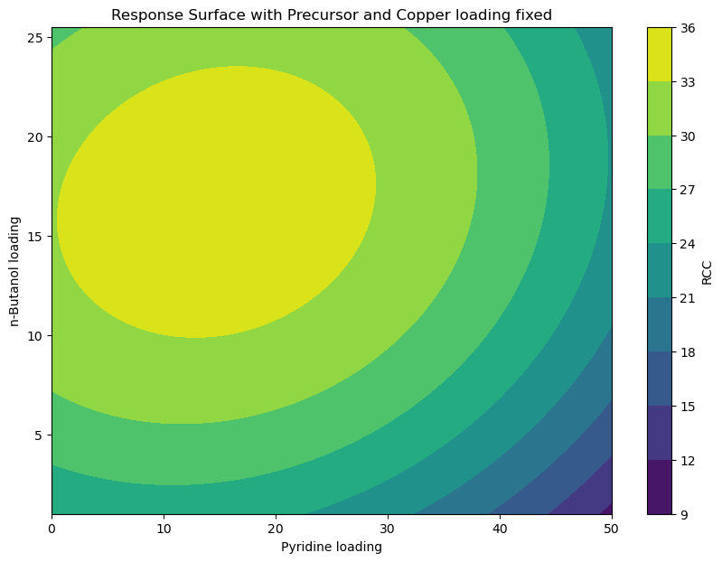
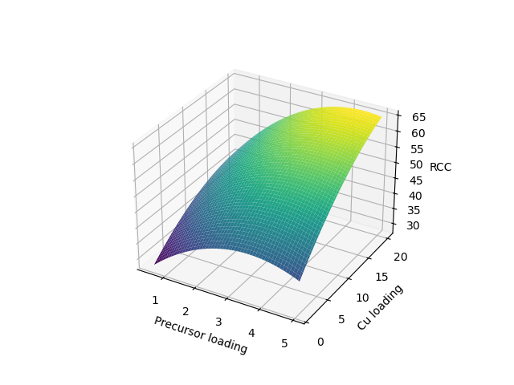

# HTE Reaction Optimization: Design of Experiments & Response Surface Modeling

Objective: Optimize a multi-variable reaction for high-throughput experimentation (HTE) by generating a face-centered Central Composite Design (CCD), fitting a second-order regression model to the experimental results, and visualizing the response surface to identify optimal conditions.

## Project Context
* **Research project:** Combining High-Throughput Radiochemical Experimentation with "Design of Experiments" to Accelerate the Radiosynthetic Optimization of Novel Radiopharmaceuticals
* **Lab:** Scott Lab (Peter J. H. Scott), Department of Radiology, University of Michigan
* **My role:** Designed a Python workflow for experimental design generation, regression modeling, and response surface visualization.
* **Goal:** Replace one-factor-at-a-time screening with a DoE-driven approach that captures variable interactions in far fewer runs.
* Demonstrated on a sample dataset; real experimental data will be added as it is collected.

## Input Data
* **Variables and levels:** `VolTestFDOPA.csv` defines each variable levels. This is the only file you need to edit to design a new study.
* **Experimental design:** `DOE_table.csv` is generated automatically from the file above.
* **Experimental results:** After running the experiments, the measured response is added to the design table and used to fit the model.
* **Sample data:** `DOE_table-2.csv` is a placeholder file with simulated responses, included so the modeling and plotting steps can be run before real data exists. Results from this file are for demonstration only.

| Variable | Code | Unit | Range |
| :--- | :---: | :--- | :---: |
| Precursor loading | `Pre` | $\mu L$ | 0.5 - 5.0 |
| Copper loading | `Cu` | $\mu L$ | 1.0 - 20.0 |
| n-Butanol | `Bu` | $\mu L$  | 0.0 - 50.0 |
| Pyridine loading | `Pyr` | $\mu L$  | 1.0 - 25.5 |

**Response:** `RCC` (radiochemical conversion, %)

## Methods
* **Design of Experiments:** Face-centered Central Composite Design (`face='ccf'`) generated with [`doepy`](https://github.com/tirthajyoti/doepy). A CCD combines factorial, axial, and center points, allowing curvature to be estimated with far fewer runs than a full factorial design. The face-centered variant places axial points on the faces of the design space, so every run stays within the specified ranges (the default circumscribed design produces out-of-range values such as negative volumes).
* **Model:** Second-order polynomial multiple linear regression (main effects, quadratic terms, and two-way interactions) fit with `scikit-learn` (`PolynomialFeatures` + `LinearRegression`), evaluated on a held-out 20% test split.
* **Response surface:** Two variables are varied across their ranges while the others are held constant, and predicted RCC is shown as a 2D contour map and a 3D surface.

The model takes the form:

```
y = β₀ + Σ βᵢxᵢ + Σ βᵢᵢxᵢ² + Σ βᵢⱼxᵢxⱼ + ε
```

## Results & Evaluation

> **Note:** The values below come from the sample file `DOE_table-2.csv` and are placeholders. Update this section once real experimental data is available.

### Model Performance
| Metric | Value |
| :--- | :---: |
| R² (test set) | `0.9547` |
| Mean Squared Error (test set) | `10.80` |

### Visual Evaluation
#### 2D Contour Plot (n-Butanol volume vs. Pyridine volume)

 
#### 3D Response Surface (Precursor volume vs. Cu volume)


## Quick Start
 
### Prerequisites
* **Python 3.10+**
* **Jupyter Notebook** or **JupyterLab** *(or Google Colab / VS Code)*
### Running the Project
1. Clone this repository:
```bash
git clone https://github.com/hanange39/umich-scott-lab-doe-summer2024.git
```
2. Navigate to the folder:
```bash
cd umich-scott-lab-doe-summer2024
```
3. Install the required libraries:
```bash
pip install doepy pydoe2 diversipy pandas numpy scikit-learn matplotlib jupyter
```
4. Enter your variables and their low/high levels in `VolTestFDOPA.csv`.
5. Launch the Jupyter Notebook environment:
```bash
jupyter notebook
```
6. Run the first cells to generate `DOE_table.csv`, the list of conditions to run.
7. Run the experiments and record the measured `RCC` for each row of the design table.
8. Update the data file name in the modeling cell (currently `DOE_table-2.csv`, the sample file) to point to your completed table, then run the remaining cells to fit the model and generate the plots.
## Project Structure
```
.
├── doe-test.ipynb            # Design generation, model fitting, and plotting
├── VolTestFDOPA.csv          # Input: variables and levels
├── DOE_table.csv             # Generated: CCD experiment table
├── DOE_table-2.csv           # Sample: design table with simulated RCC responses
├── contour_plot.png          # Saved plots
├── surface_plot.png          
└── README.md
```
 
## Limitations & Future Work
* Results are currently based on simulated data and need to be regenerated with real experimental measurements.
* With a small CCD dataset, a single train/test split is unreliable. Cross-validation or confirmation runs at predicted optima would be more informative.

## Built With
* **Python 3**
* **Jupyter Notebook**
* **DoE:** `doepy`, `pyDOE2`
* **Modeling:** `scikit-learn`
* **Data & Visualization:** `pandas`, `numpy`, `matplotlib`
